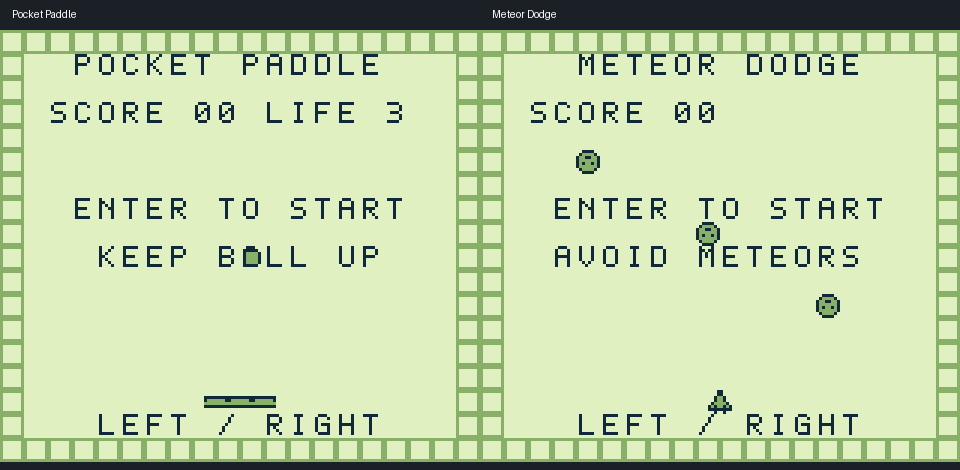

# Included games

The repository includes two example game ROMs and a sprite demo.
They run through the emulated CPU, memory bus, joypad and graphics hardware.
Their gameplay is not built into the Windows frontend.

## Pocket Paddle — press 1 to open

- Press Enter to start or restart.
- Move with Left/Right and catch the falling ball with the paddle.
- Each return earns one point. Missing the ball costs a life; you start with three.
- The score stops at 99. This is a paddle challenge, not a brick-breaking game.

## Meteor Dodge — press 2 to open

- Press Enter to start or restart.
- Move the ship with Left/Right and avoid the three falling meteors.
- Each safely avoided meteor earns one point. A collision ends the run.
- The meteors become faster at ten points. The score stops at 99.

## Sprite demo — press 3 to open

Use the arrow keys to move the diamond, Z/X to change its palette, and Enter to
center it. It is a small example of input affecting sprite memory.

## ROMs and game memory

The optional Python sources are in tools/make_demo.py and tools/make_games.py.
They contain the game instructions and pixel assets, and need no external
assembler. From the project folder, run `python tools/make_demo.py` and then
`python tools/make_games.py` to regenerate the ROMs. The ready-to-run files are
already included; 

All three ROMs are 32 KiB, type 0x00, with no cartridge RAM or saves. They omit
the Nintendo logo data and are intended for emulators that skip the boot ROM;
they do not pass an original Game Boy boot ROM's logo check.

The games draw their scoreboards in the background tile map and use 8x8 sprites.
They do not require a window layer, tall sprites, or serial transfers.

These game-specific working-RAM addresses help explain the game checks:

| Address | Meaning |
| --- | --- |
| C000 | State: 0 title, 1 playing, 2 game over |
| C001 | Player X position |
| C002 / C003 | Paddle ball X / Y |
| C004 / C005 | Paddle ball direction: 1 or 255 (-1) |
| C006 / C007 | Score ones / tens |
| C008 | Paddle lives |
| C009 | Meteor frame counter |
| C020 / C021 | First meteor X / Y |
| C022 / C023 | Second meteor X / Y |
| C024 / C025 | Third meteor X / Y |

Example title screens rendered from the included ROMs:

